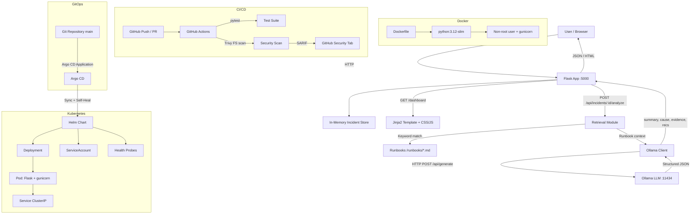

# AI DevOps Incident Intelligence

A lightweight Flask application for simulating DevOps incidents, retrieving
relevant runbooks, and generating AI-powered incident analysis using a local
Ollama model.

## Features

- **Incident Reporting** — Create and list simulated `http_500` and `high_latency`
  incidents via a REST API or a web dashboard.
- **AI Analysis** — Request structured incident analysis (summary, likely cause,
  evidence, recommendations) from a local Ollama model with runbook retrieval.
- **Runbook Retrieval** — Keyword-based retrieval selects the most relevant
  runbook to provide context for AI analysis. No vector database required.
- **Dashboard** — Responsive HTML/CSS dashboard for creating incidents and
  viewing AI analysis results.
- **Docker** — Production-ready Dockerfile with non-root user and gunicorn.
- **Helm Chart** — Kubernetes deployment with secure container settings,
  resource limits, and health probes.
- **CI/CD** — GitHub Actions workflow running pytest and Trivy security scans.
- **GitOps** — Argo CD Application manifest for automated Kubernetes deployment
  with sync, prune, and self-heal.

## Architecture



## Quick Start

### Prerequisites

- Python 3.12
- [Ollama](https://ollama.ai) installed locally (for AI analysis)
- Docker (optional, for containerized deployment)
- Helm 3.x (optional, for Kubernetes deployment)

### Local Development

```bash
# Create and activate a virtual environment
python -m venv .venv

# Windows
.venv\Scripts\activate
# Linux/macOS
source .venv/bin/activate

# Install dependencies
pip install -r requirements.txt

# Run the application (serves on 0.0.0.0:5000)
python app.py
```

### Running Tests

```bash
pytest test_app.py test_analysis.py test_dashboard.py -v
```

Tests mock the Ollama HTTP API — no running model is required.

## API Endpoints

| Method | Endpoint | Description |
|--------|----------|-------------|
| GET | `/` | Service information (JSON) |
| GET | `/health` | Health check (JSON) |
| GET | `/api/incidents` | List all incidents |
| POST | `/api/incidents` | Create a new incident |
| POST | `/api/incidents/<id>/analyze` | Request AI analysis for an incident |
| GET | `/dashboard` | Web dashboard (HTML) |

### Creating an Incident

```bash
curl -X POST http://localhost:5000/api/incidents \
  -H "Content-Type: application/json" \
  -d '{"incident_type": "http_500", "description": "Checkout page 500 error", "severity": "high"}'
```

### Requesting Analysis

```bash
curl -X POST http://localhost:5000/api/incidents/<incident_id>/analyze
```

## Docker

### Build and Run

The Dockerfile uses `python:3.12-slim`, runs as a non-root user, and serves
with gunicorn (2 workers).

```bash
# Build the image (tag it with your own registry path)
docker build -t ai-devops-incident-intelligence .

# Run the container, forwarding port 5000
docker run -p 5000:5000 \
  -e OLLAMA_BASE_URL=http://host.docker.internal:11434 \
  ai-devops-incident-intelligence
```

### Reaching Ollama from Docker

When running inside Docker, `localhost` refers to the container itself, not
the host machine. Use one of the following to let the container reach Ollama:

| Platform | OLLAMA_BASE_URL | Notes |
|----------|----------------|-------|
| Docker Desktop (Mac/Windows) | `http://host.docker.internal:11434` | Built-in DNS alias for the host |
| Linux | `http://<host-ip>:11434` | Use the host's LAN IP, or `--network host` |
| Docker Compose | `http://ollama:11434` | If Ollama runs as a Compose service |

## Ollama Configuration

The application needs a running Ollama instance to generate AI analysis.
Configure it with environment variables:

| Variable | Default | Description |
|----------|---------|-------------|
| `PORT` | `5000` | Port the Flask/gunicorn server listens on |
| `OLLAMA_BASE_URL` | `http://localhost:11434` | Ollama API base URL |
| `OLLAMA_MODEL` | `llama3.2:latest` | Ollama model name |

When running locally, the default works if Ollama is installed on the same
machine. When running in Docker or Kubernetes, set `OLLAMA_BASE_URL` to the
address the container can use to reach the Ollama service.

## Kubernetes Deployment with Helm

### Prerequisites

- A running Kubernetes cluster (e.g. [kind](https://kind.sigs.k8s.io/),
  minikube, or a cloud provider)
- Helm 3.x installed
- **A container image built and pushed to a registry your cluster can reach.**
  The Helm chart does not build the image for you. Build it from the Dockerfile
  and push it to your own registry:

  ```bash
  # Build and push — replace with your actual registry path
  docker build -t YOUR_REGISTRY/ai-devops-incident-intelligence:YOUR_TAG .
  docker push YOUR_REGISTRY/ai-devops-incident-intelligence:YOUR_TAG
  ```

  Then pass your repository and tag to Helm (see below).

### Deploy

```bash
# Install the chart — set image.repository and image.tag to the image you pushed
helm install incident-intelligence ./helm/ai-devops-incident-intelligence \
  --set image.repository=YOUR_REGISTRY/ai-devops-incident-intelligence \
  --set image.tag=YOUR_TAG \
  --set env.OLLAMA_BASE_URL=http://ollama-service:11434

# Verify the deployment
kubectl get pods -l app.kubernetes.io/name=ai-devops-incident-intelligence

# Port-forward for local access
kubectl port-forward svc/incident-intelligence-ai-devops-incident-intelligence 5000:80
```

### Helm Configuration

Key values can be overridden with `--set` or a custom values file:

| Parameter | Default | Description |
|-----------|---------|-------------|
| `image.repository` | _(none — required)_ | Container image repository (build and push your own) |
| `image.tag` | _(none — required)_ | Container image tag |
| `replicaCount` | `1` | Number of pod replicas |
| `service.type` | `ClusterIP` | Kubernetes Service type |
| `service.port` | `80` | Service port |
| `env.PORT` | `5000` | Container listen port |
| `env.OLLAMA_BASE_URL` | `http://localhost:11434` | Ollama URL |
| `env.OLLAMA_MODEL` | `llama3.2:latest` | Ollama model name |
| `resources.requests.cpu` | `100m` | CPU request |
| `resources.requests.memory` | `128Mi` | Memory request |
| `resources.limits.cpu` | `500m` | CPU limit |
| `resources.limits.memory` | `256Mi` | Memory limit |

### Validate the Chart

```bash
# Lint the chart
helm lint ./helm/ai-devops-incident-intelligence

# Render templates without deploying
helm template ./helm/ai-devops-incident-intelligence
```

## CI/CD

The GitHub Actions workflow (`.github/workflows/ci.yml`) runs on every push and
pull request:

1. **Test job** — Installs dependencies from `requirements.txt` and runs the
   full pytest suite (`test_app.py`, `test_analysis.py`, `test_dashboard.py`).
2. **Trivy security scan** — Scans the repository filesystem for HIGH and
   CRITICAL vulnerabilities, secrets, and misconfigurations. Results are
   uploaded as SARIF to the GitHub Security tab.

## GitOps with Argo CD

The Argo CD Application manifest (`argocd/application.yaml`) deploys the Helm
chart automatically from this Git repository:

- Watches the `main` branch for changes.
- Deploys the Helm chart from `helm/ai-devops-incident-intelligence/`.
- Creates the `ai-devops` namespace automatically.
- Automated sync with prune and self-heal — Git is the single source of truth.

### Apply the Application

```bash
# Prerequisite: Argo CD installed and this repo registered
argocd repo add https://github.com/samkeerthana98/ai-devops-incident-intelligence.git

# Apply the Application manifest
kubectl apply -f argocd/application.yaml

# Check sync status
argocd app get ai-devops-incident-intelligence
```

See [docs/gitops.md](docs/gitops.md) for the full GitOps workflow guide.

## Security Note

AI-generated analysis — summaries, likely causes, and recommendations — is
**advisory only**. It is produced by a local language model and may be
inaccurate or incomplete. Always review the output before taking any action
in production. Never execute commands suggested by the model without first
verifying them independently.

## Project Structure

```
ai-devops-incident-intelligence/
├── app.py                  # Flask application with all endpoints
├── ollama_client.py        # Ollama HTTP API integration
├── retrieval.py            # Keyword-based runbook retrieval
├── requirements.txt        # Python dependencies
├── test_app.py             # Phase 1 tests (API endpoints)
├── test_analysis.py        # Phase 2 tests (analysis + retrieval)
├── test_dashboard.py       # Phase 3 tests (dashboard routes)
├── Dockerfile              # Production Docker image
├── .dockerignore           # Docker build exclusions
├── runbooks/               # Markdown runbooks for incident types
│   ├── http_500.md
│   ├── high_latency.md
│   └── general_troubleshooting.md
├── templates/
│   └── dashboard.html      # Jinja2 dashboard template
├── static/
│   ├── css/dashboard.css   # Responsive dashboard styles
│   └── js/dashboard.js     # Vanilla JS for dashboard interactions
├── helm/
│   └── ai-devops-incident-intelligence/
│       ├── Chart.yaml       # Helm chart metadata
│       ├── values.yaml      # Default values
│       └── templates/
│           ├── _helpers.tpl   # Template helpers
│           ├── NOTES.txt      # Post-install notes
│           ├── deployment.yaml
│           ├── service.yaml
│           └── serviceaccount.yaml
├── argocd/
│   └── application.yaml    # Argo CD Application manifest
├── docs/
│   └── gitops.md           # GitOps workflow guide
└── .github/
    └── workflows/
        └── ci.yml          # GitHub Actions CI workflow
```
